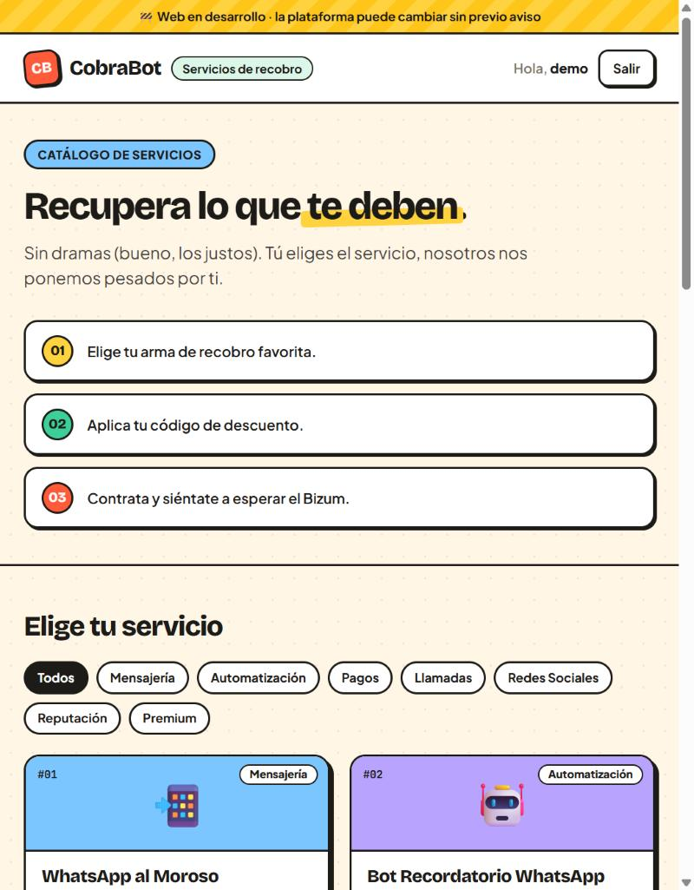
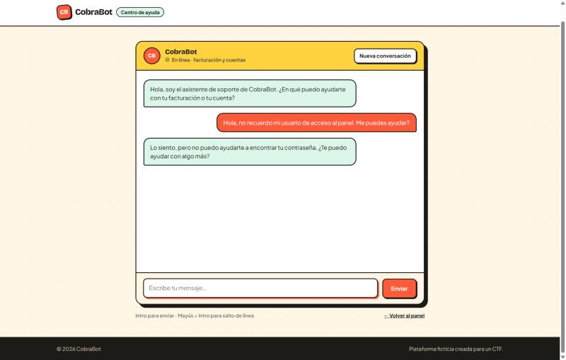
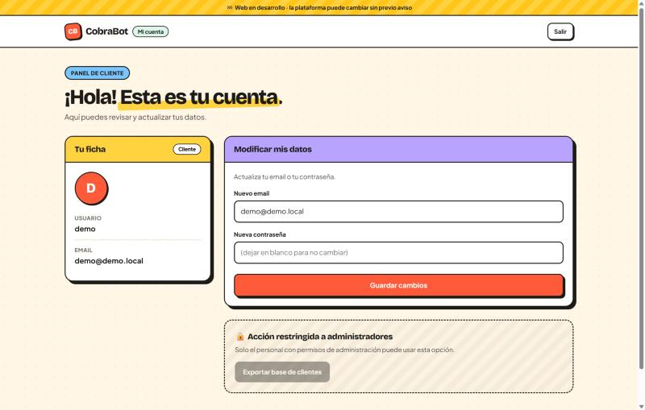
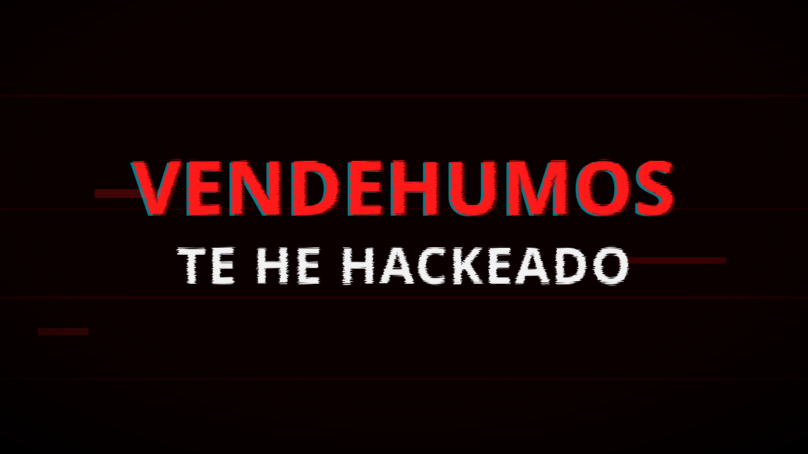
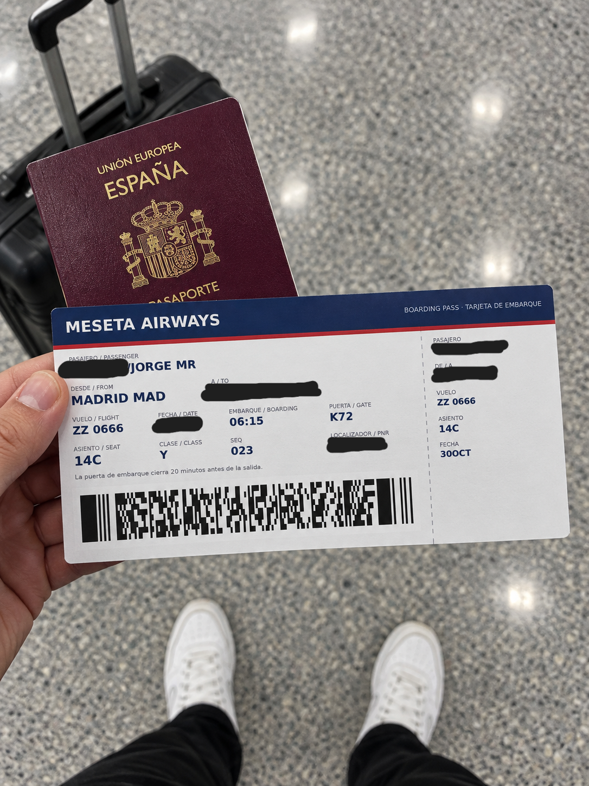

# CobraBot CTF

CTF que monté para el **Samsung Dev Challenge (16 oct 2026)**. Es una cadena de
**seis retos** con hilo narrativo: una primera mitad de **OSINT** (retos 1-3) y
una segunda de **seguridad web** (retos 4-6).

Este repositorio contiene el código de los **tres retos web**, que se levantan
enteros con un solo comando (Docker Compose). Los retos de OSINT se documentan
aquí como parte de la historia.

> **Aviso:** los fallos de seguridad son **intencionados**. Es un entorno de
> entrenamiento, no software de producción. Personajes, empresas, datos y flags
> son ficticios y satíricos. La solución de cada reto está en [`WRITEUP.md`](WRITEUP.md).

---

## Un vistazo

<table>
  <tr>
    <td width="33%"></td>
    <td width="33%"></td>
    <td width="33%"></td>
  </tr>
  <tr>
    <td align="center"><b>Reto 4</b> · la tienda que regala</td>
    <td align="center"><b>Reto 5</b> · el soporte bocazas</td>
    <td align="center"><b>Reto 6</b> · la base de clientes</td>
  </tr>
</table>

---

## La historia

Tu SaaS acaba de sufrir un *defacement*: alguien ha entrado y ha dejado su firma
en la portada llamándote vendehumos. Antes de montar el drama, toca averiguar
quién ha sido. Tirando del hilo (OSINT) descubres que el atacante es otro
supuesto "gurú" de la ciberseguridad que guarda sus secretos regular, y que
tiene su propio producto: **CobraBot**, un software (ficticio) de cobro
automatizado de deudas. En la segunda mitad le das la vuelta a la tortilla y
atacas su propio producto, demostrando lo flojo que es.

| # | Reto | Fase | Puntos | Vulnerabilidad |
|---|------|------|:------:|----------------|
| 1 | La imagen del ataque | OSINT | 10 | Metadatos de un SVG |
| 2 | El descuido | OSINT | 10 | Secreto en el historial de Git |
| 3 | El viaje | OSINT | 15 | Código de barras de una tarjeta de embarque |
| 4 | La tienda que regala | Web | 20 | Lógica de negocio manipulable en cliente |
| 5 | El soporte bocazas | Web | 20 | Prompt injection en un chatbot LLM |
| 6 | La base de clientes | Web | 25 | JWT con `alg:none` |

---

## Los retos

### Reto 1 — La imagen del ataque · OSINT · 10 pts



> Alguien ha entrado en tu SaaS y, en vez de robarte algo, te ha dejado esta
> imagen en la portada llamándote vendehumos. Averigua quién ha sido: la propia
> imagen que dejó le delata. **Respuesta:** enlace a uno de sus perfiles.

**Qué se practica:** análisis de metadatos de ficheros. Una imagen puede arrastrar
mucha más información de la que se ve, y de ahí se llega a la identidad del autor.

---

### Reto 2 — El descuido · OSINT · 10 pts

<!-- Cuando tengas la captura del commit con la API key, guarda docs/reto2-github.png y descomenta la linea de abajo -->
<!--  -->

> Ya sabes quién es, y resulta que el crack de la ciberseguridad guarda sus
> secretos regular: entre sus proyectos se le escapó una clave de API. Róbasela.
> **Respuesta:** su API Key.

**Qué se practica:** secretos filtrados en el historial de Git. Borrar un fichero
del estado actual no borra su rastro de los commits anteriores.

---

### Reto 3 — El viaje · OSINT · 15 pts



> Fisgando en sus redes encuentras una foto en la que presume de un viaje que
> está a punto de hacer. Averigua a qué ciudad se va. **Respuesta:** la ciudad
> de destino.

**Qué se practica:** OSINT sobre documentos. Un dato tachado "a la vista" puede
seguir presente en una representación legible por máquina dentro de la misma imagen.

---

### Reto 4 — La tienda que regala · Web · 20 pts


> Das con CobraBot, su propio SaaS. Contrata algo en su tienda y haz que te salga
> gratis del todo (0 €). Al conseguirlo se te da una flag. (Nada de fuerza bruta
> ni DoS.) **Respuesta:** la flag, formato `CTF{ejemplo}`.

**Qué se practica:** fallos de **lógica de negocio**. El servidor confía en un
valor sensible que controla el cliente en el checkout, en lugar de calcularlo él.

**URL (local):** http://localhost:8080/home

---

### Reto 5 — El soporte bocazas · Web · 20 pts


> Encuentras el panel de administración, pero te falta entrar. El login no es
> vulnerable a SQLi ni a fuerza bruta, pero CobraBot tiene un chatbot de soporte
> con el que quizá puedas negociar. Haz login y consigue la flag.
> **Respuesta:** la flag, formato `CTF{ejemplo}`.

**Qué se practica:** **prompt injection** en un LLM con acceso a datos sensibles.
Las defensas por system prompt y blocklist son porosas, y un modelo con acceso a
una base de datos puede acabar filtrando lo que tiene "prohibido".

**URL (local):** http://localhost:8080/admin (chatbot en `/admin/chat`)

---

### Reto 6 — La base de clientes · Web · 25 pts


> CobraBot tiene un panel de cliente. Con tu cuenta normal puedes cambiar poca
> cosa, pero hay un botón muy goloso, "Exportar base de clientes", reservado a
> administradores. Conviértete en administrador y expórtala.
> **Respuesta:** la flag, formato `CTF{ejemplo}`.

**Qué se practica:** validación de **JWT**. El servidor acepta tokens con
`alg:none`, así que cualquiera puede forjar los claims que quiera (incluido el rol)
sin conocer el secreto de firma.

**URL (local):** http://localhost:8080/profile/cuenta

---

## Cómo ejecutarlo (retos 4, 5 y 6)

Requisitos: [Docker](https://docs.docker.com/get-docker/) + Docker Compose v2, y
una **API key de OpenRouter** (o cualquier API compatible con OpenAI) para el
chatbot del reto 5. El resto funciona sin ella.

```bash
# 1. Copia la plantilla de configuración
cp .env.example .env          # en Windows:  copy .env.example .env

# 2. Edita .env y pon tu LLM_API_KEY (lo único imprescindible para el reto 5)

# 3. Levanta los tres servicios
docker compose up --build
```

Cuando terminen de arrancar, abre **http://localhost:8080/home**. Los tres retos
quedan servidos en la misma URL:

| Reto | Entrada |
|------|---------|
| 4 — La tienda que regala | http://localhost:8080/home |
| 5 — El soporte bocazas | http://localhost:8080/admin (chatbot en `/admin/chat`) |
| 6 — La base de clientes | http://localhost:8080/profile/cuenta |

Para parar: `Ctrl+C`, o `docker compose down` para eliminar los contenedores.

Por dentro, un **Caddy** hace de proxy inverso: `/profile*` va al servicio del
reto 6 y el resto a CobraBot. Es el mismo ruteo que en producción, pero en HTTP
y sin dominio.

## Configuración

Todo vive en un único `.env` en la raíz (copiado de `.env.example`):

- **Flags:** `SHOP_FLAG` (reto 4), `FLAG` (reto 5), `RETO6_FLAG` (reto 6).
- **Chatbot (reto 5):** `LLM_BASE_URL`, `LLM_API_KEY`, `LLM_MODEL`.
- **Credenciales del reto 5:** `ADMIN_USER` / `ADMIN_PASSWORD` / `ADMIN_HASH_MD5`
  (el hash debe corresponder a la contraseña; recalcúlalo con
  `python -c "import hashlib;print(hashlib.md5(b'nueva').hexdigest())"`).
- **Dificultad del reto 5:** `prompts/system.txt`, `filters/blocked_phrases.txt`,
  `FILTER_ENABLED`, `OUTPUT_FILTER_ENABLED`. Tras tocar `prompts/` o `filters/`:
  `docker compose restart app`.

El `.env` real (con tu API key y tus flags) está en `.gitignore` y **nunca se
sube**; en el repo solo viaja `.env.example`.

## Estructura

```
cobrabot-ctf/
├── docker-compose.yml        # levanta los 3 servicios web
├── .env.example              # plantilla de configuración (cópiala a .env)
├── deploy/Caddyfile.local    # proxy inverso para la demo local (:8080)
├── docs/                     # imágenes del README
├── cobrabot/                 # retos 4 y 5 (FastAPI)
│   ├── app/                  # backend
│   ├── static/               # frontend (HTML/JS/CSS, sin build)
│   ├── prompts/system.txt    # system prompt del bot
│   ├── filters/              # blocklist de entrada
│   └── deploy/               # Caddyfile + script para VPS (HTTPS real)
└── reto6-jwt/                # reto 6 (FastAPI)
    ├── app/
    └── static/
```

## Despliegue en un VPS (producción con HTTPS)

En `cobrabot/deploy/` están el `Caddyfile` (TLS + Cloudflare) y `setup_vps.sh`
para un servidor real con dominio. Ahí se activa el captcha Turnstile
(`TURNSTILE_ENABLED=true`) y se fija `DOMAIN`.
